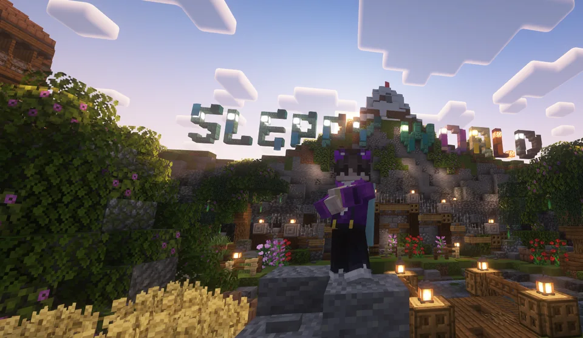
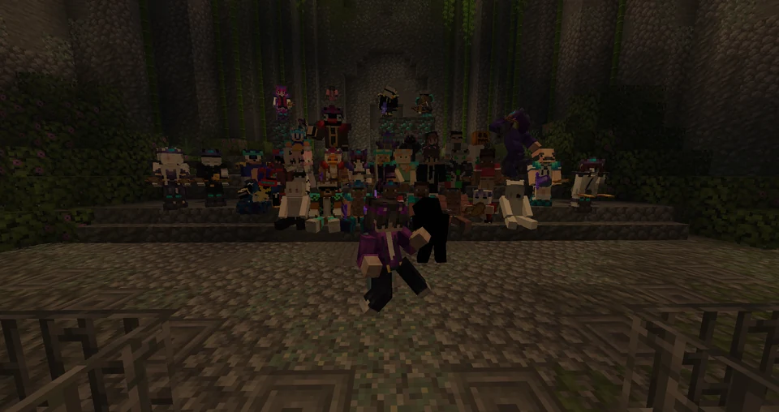
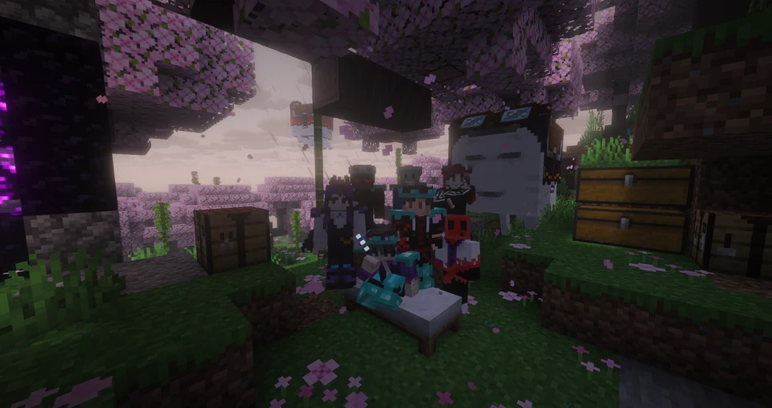
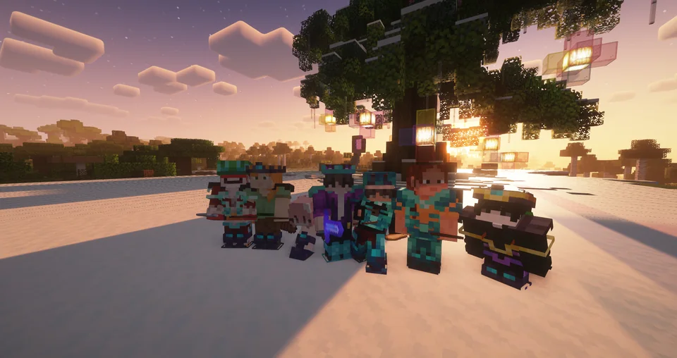
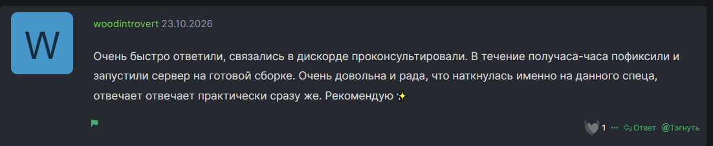

  

  
  
  

### 👋 Привет, я DeLfi

Делаю Minecraft сервера, плагины и ивенты на заказ. Мой главный проект **SleppyShel**: ванильное выживание, идёт уже 5 сезон, в Discord около 500 человек. Всё, что ниже, сделано и проверено на нём.

**Чем могу помочь**

- 🖥 **Сервер под ключ**: от идеи до открытия, хостинг, права, защита, оптимизация
- ⚔ **Плагины на Paper**: от мелких фич до сложных систем
- 🎬 **Ивенты**: катсцены, боссы, квесты, мини-игры
- 🧪 **Сборки модов**: спавн мобов, лут, крафты (KubeJS)
- 🤖 **Discord-боты**: заявки, тикеты, роли, привязка к серверу

 

---

### 📸 Как это выглядит

<table>
  <tr>
    <td width="50%"> 4 сезон, открытие Энда</td>
    <td width="50%"> 4 сезон: 42 игрока онлайн</td>
  </tr>
  <tr>
    <td width="50%"> С ребятами под сакурой</td>
    <td width="50%"> Отмечали Новый год</td>
  </tr>
</table>

### 🧩 Свои плагины, которых нет в открытом доступе

| | Для чего | Что умеет |
|---|---|---|
| **SleppyEvent** | большие ивенты | отдельный мир, режим сценариста, сбор игроков одной командой, катсцены |
| **SleppyTools** | модерация и сезон | меню модератора, баны в игровом чате, свои достижения, привязка к Discord |
| **Discord-бот** | Discord-сервер | заявки на вход, приветствия, напоминания, сбор средств с прогрессом |

### 💬 Что говорят

> Нашёл на сайте, сделал всё качественно и быстро, буду обращаться ещё.
> Mowi, 5 звёзд из 5

### 💰 Цены

| Задача | Цена |
|---|---|
| Плагины, моды и мелкие задачи | от 500 ₽ |
| Настройка, запуск и поддержка сервера | от 1 500 ₽ |
| Сервер под ключ | от 3 500 ₽ |

7 дней бесплатных правок после сдачи и 14 дней гарантии на ошибки по моей вине.

### 🛠 Инструменты

  

---

  <b>Есть идея или сломался сервер?</b> Напиши в <a href="https://t.me/Delfi_D">Telegram</a>, разберёмся 🙂

