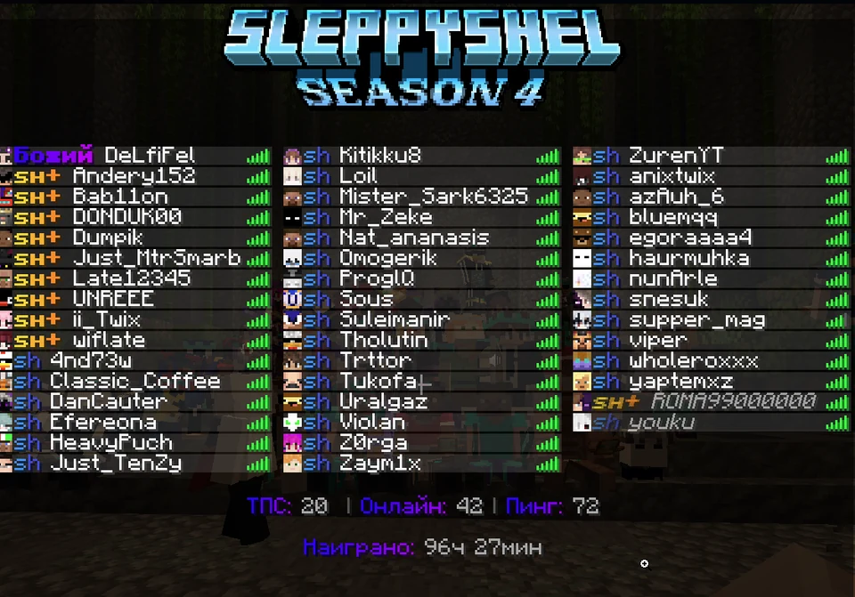

<picture>
  <source media="(prefers-color-scheme: dark)" srcset="assets/header-dark.svg">
  
</picture>

Разрабатываю Minecraft-серверы на заказ: от архитектуры и плагинов до запуска и поддержки. Веду собственный проект **SleppyShel**, на котором проверяю всё, что делаю для клиентов.

<picture>
  <source media="(prefers-color-scheme: dark)" srcset="assets/stats-dark.svg">
  
</picture>

### Направления

| Направление | Что делаю |
|---|---|
| **Серверы под ключ** | Paper / Purpur, прокси, права, защита, авторизация, бэкапы, оптимизация под онлайн |
| **Плагины** | Java / Kotlin на Paper API: игровые системы, экономика, ивенты, интеграции с Discord |
| **Ивенты и сценарии** | Катсцены, боссы, многоэтапные события с отдельным миром и режимом сценариста |
| **Модпаки** | Forge / NeoForge: спавн, лут-таблицы, рецепты (датапаки, KubeJS) |
| **Инфраструктура** | Linux VPS, Pterodactyl, nginx, systemd, мониторинг и профилирование (spark) |

### Избранные работы

**SleppyShel**: ванильное выживание с сюжетом, 5-й сезон, до 42 игроков онлайн, около 500 участников в Discord. Полный цикл: сервер, плагины, бот, ивенты.

| Проект | Назначение | Что внутри |
|---|---|---|
| **SleppyEvent** | Сценарные ивенты | Отдельный мир события, режим сценариста, сбор игроков, катсцены на display-сущностях |
| **SleppyTools** | Модерация и сезон | Меню модератора, публичные наказания, сезонные достижения, привязка к Discord |
| **Discord-бот** | Сообщество | Заявки на вход, онбординг, напоминания, сбор средств с прогрессом |

<table>
  <tr>
    <td width="50%"></td>
    <td width="50%"></td>
  </tr>
  <tr>
    <td>Ивент открытия Энда, 4 сезон</td>
    <td>Пиковый онлайн 4 сезона</td>
  </tr>
</table>

### Сейчас в работе

- 5-й сезон SleppyShel: сюжетные ивенты и подготовка к открытию Энда
- Заказы: плагины под Paper и настройка модпаков на Forge

### Стек

`Java` `Kotlin` `Paper API` `Gradle` `Datapacks` `KubeJS` `Python` `TypeScript` `React` `Linux` `nginx` `Docker` `Pterodactyl`

### Работа со мной

- Оценка и сроки после разбора задачи, оплата 50/50
- Исходники и конфиги передаются заказчику
- 7 дней правок после сдачи, 14 дней гарантии на свои ошибки

**Связь:** [Telegram @Delfi_D](https://t.me/Delfi_D) · Discord `delfi_sh` · [Портфолио](https://sleppyworlds.ru/delfi)
